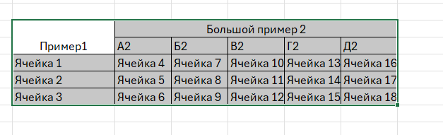
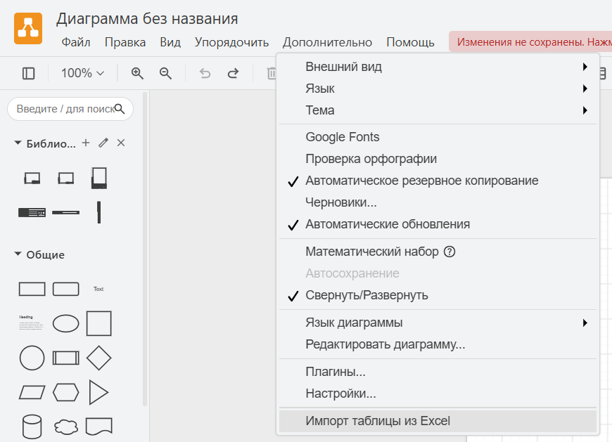
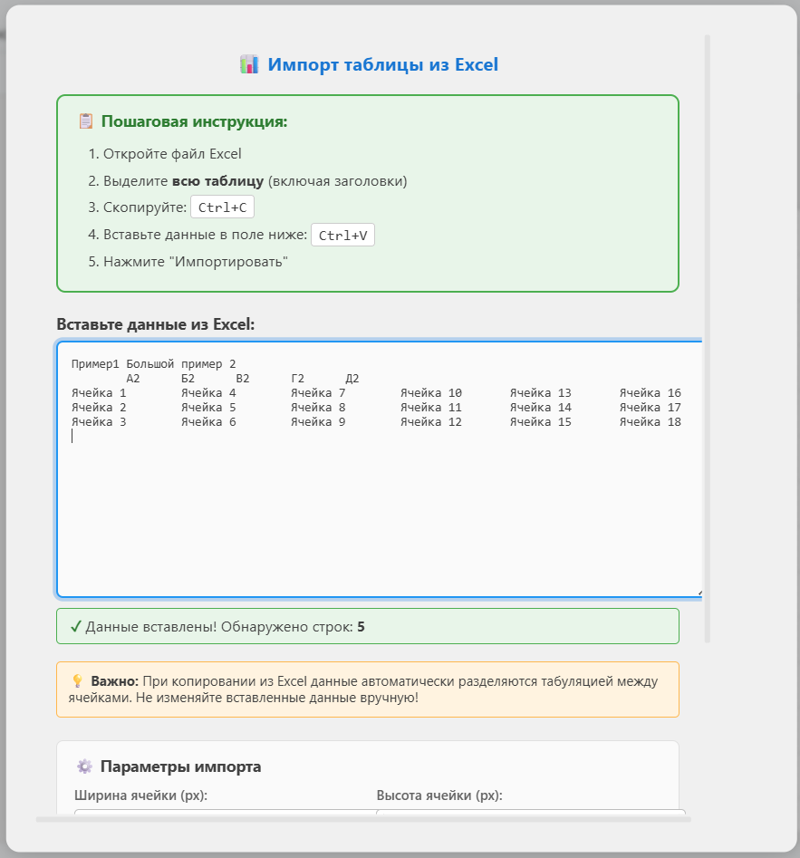
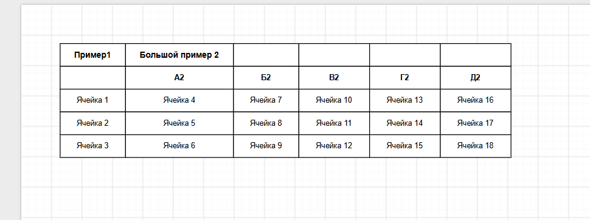

# Draw.IO-excel-to-diagram-plugin Excel Table Import Plugin for draw.io (diagrams.net)


!Внимание! Данный проект был создан с помощью ИИ!!!


Плагин для [draw.io](https://app.diagrams.net/) (десктопного приложения), позволяющий мгновенно импортировать таблицы из Microsoft Excel, Google Таблиц и LibreOffice Calc напрямую на холст диаграммы через буфер обмена.

---

## 📸 Как это работает (Пошаговый процесс)

### Шаг 1. Копирование данных в Excel
Выделите таблицу в табличном редакторе (включая заголовки) и нажмите <kbd>Ctrl</kbd> + <kbd>C</kbd>:



---

### Шаг 2. Вызов плагина в draw.io
В верхнем меню draw.io перейдите в раздел **Дополнительно (Extras)** → **«📊 Импорт таблицы из Excel»**:



---

### Шаг 3. Вставка данных и настройка
Вставьте скопированные данные в текстовое поле (<kbd>Ctrl</kbd> + <kbd>V</kbd>), выберите необходимые параметры форматирования и нажмите кнопку **«🚀 Импортировать»**:



---

### Шаг 4. Готовая таблица на холсте
Таблица автоматически отрисовывается, подгоняет ширину колонок под текст и группируется в единый блок для удобного перемещения. Объединение табличек делать самостоятельно.



---

## 📌 Основные возможности

- **Импорт без промежуточных файлов**: не требуется сохранять CSV или TSV файлы на диск — данные передаются напрямую через буфер обмена.
- **Интеллектуальная авто-ширина (Auto-width)**: алгоритм вычисляет ширину каждого столбца по максимальной длине текстовых строк.
- **Поддержка многострочного текста**: перенос строк (`\n`) внутри ячеек сохраняется, высота ячейки рассчитывается пропорционально количеству строк.
- **Автоматическая группировка**: все созданные ячейки таблицы объединяются в группу mxGraph, что предотвращает случайное смещение отдельных элементов.
- **Визуальное разделение заголовков**: первая и вторая строки автоматически оформляются полужирным шрифтом.
- **Гибкая настройка**: возможность включать/отключать границы, переопределять размеры ячеек и управлять выравниванием.

---

## ⚠️ Важно: Особенности draw.io Desktop (версии 32+)

Начиная с версии **draw.io Desktop 32.x**, разработчики удалили штатную возможность загружать сторонние `.js`-плагины через меню приложения по соображениям безопасности Electron (параметр `--enable-plugins` отключён, а в коде оставлена поддержка только предустановленных системных плагинов).

Попытка добавить внешний `.js` через `Extras → Plugins...` в современном десктопном клиенте больше не работает. 

Чтобы решить эту проблему, для десктопных версий подготовлены **автономные установщики**, которые корректно интегрируют плагин в пакет `app.asar` с обязательным созданием резервной копии оригинала.

---

## 🚀 Установка плагина

Для пользователей Windows в репозитории собран компактный автономный графический установщик:
👉 **[`Setup-DrawIO-ExcelPlugin.exe`](Setup-DrawIO-ExcelPlugin.exe)** (~36 КБ).

#### Особенности установщика:
- **Полная автономность:** не требует наличия Python, Node.js или сторонних утилит. Код плагина уже зашит внутрь `.exe`.
- **Графический интерфейс (GUI):** аккуратное окно без черных консолей командной строки.
- **Автопоиск:** автоматически находит установленный Draw.io в `Program Files` или `%LOCALAPPDATA%`.
- **Безопасность:** перед модификацией файлов автоматически создаёт бэкап `app.asar.bak`.
- **Штатный UAC:** запрашивает права администратора стандартным системным диалогом Windows.

#### Порядок установки:
1. Закройте приложение draw.io, если оно запущено.
2. Запустите файл **`Setup-DrawIO-ExcelPlugin.exe`**.
3. Проверьте автоматически найденный путь к draw.io (при необходимости укажите вручную через «Обзор»).
4. Нажмите кнопку **«🚀 Установить плагин»**.
5. По завершении установки draw.io запустится автоматически, и в меню **«Дополнительно» (Extras)** появится пункт **«Импорт таблицы из Excel»**.

> **Откат / Удаление:** Если вы захотите вернуть стандартный draw.io, снова запустите установщик и нажмите кнопку **«Восстановить оригинал»**.

---

### Linux — Автономный Bash-скрипт

Для пользователей Linux (Ubuntu, Debian, Fedora, Arch и др.) подготовлен готовый шелл-скрипт:
👉 **[`install-drawio-plugin.sh`](install-drawio-plugin.sh)**.

#### Особенности скрипта:
- Автоматически находит директорию draw.io (`/opt/drawio`, `/usr/lib/drawio`, `~/.local/share/drawio` и пути из `$PATH`).
- Код плагина зашит внутрь скрипта в формате base64 (скрипт можно переносить одним файлом).
- Запрашивает права `sudo` только при необходимости записи в системные директории.
- Создаёт резервную копию `app.asar.bak`.

#### Порядок установки:
1. Откройте терминал в папке с файлом и сделайте скрипт исполняемым:
   ```bash
   chmod +x install-drawio-plugin.sh
   ```
2. Запустите установку:
   ```bash
   ./install-drawio-plugin.sh
   ```
   *(Если draw.io установлен в нестандартную директорию, укажите путь аргументом: `./install-drawio-plugin.sh /путь/к/папке/drawio`)*.

3. Для удаления плагина и восстановления исходного состояния:
   ```bash
   ./install-drawio-plugin.sh --uninstall
   ```

---

## ⚙️ Параметры импорта

В диалоговом окне доступны следующие настройки:

| Параметр | По умолчанию | Описание |
| :--- | :---: | :--- |
| **Ширина ячейки (px)** | `100` | Базовая ширина ячейки (используется, если отключена авто-ширина). |
| **Высота ячейки (px)** | `30` | Базовая высота строки. При многострочном тексте высота увеличивается кратно. |
| **Границы ячеек** | `Включено` | Отрисовка чёрных контуров (1px) вокруг каждой ячейки. |
| **Группировать таблицу** | `Включено` | Объединяет все ячейки таблицы в единый блок на холсте. |
| **Выделить заголовки** | `Включено` | Применяет жирный шрифт (`fontStyle=1`) для верхней строки. |
| **Авто-ширина** | `Включено` | Автоматически рассчитывает ширину каждого столбца в диапазоне от 60 до 400 px. |

---

## 🔧 Архитектура и формат данных

Плагин парсит текстовые данные стандарта TSV (Tab-Separated Values):
- **Разделитель столбцов**: символ табуляции (`\t`).
- **Разделитель строк**: перевод строки (`\r?\n`).
- **Нормализация таблицы**: строки с неполным числом колонок автоматически дополняются пустыми ячейками до максимальной ширины сетки.
- **Отрисовка**: выполняется напрямую через встроенное API mxGraph (`graph.insertVertex`), без внешних фреймворков и библиотек.

---

## 📄 Лицензия

MIT License. Свободно для коммерческого и некоммерческого использования.
